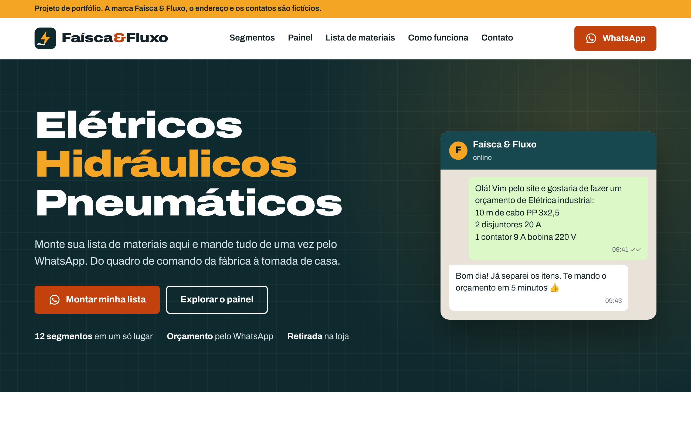
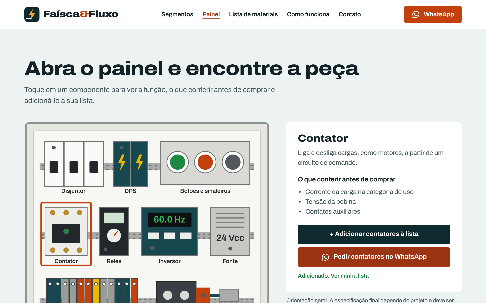

# Faísca & Fluxo

Site de uma loja de materiais elétricos, hidráulicos e pneumáticos, pensado para quem compra pelo celular e fecha pedido pelo WhatsApp.

**🔗 Ver no ar: [faisca-e-fluxo.vercel.app](https://faisca-e-fluxo.vercel.app/)**

> Projeto de portfólio. A marca, o endereço e os contatos são fictícios.



## O problema

Em loja de material elétrico, boa parte dos pedidos chega pelo WhatsApp, quase sempre como uma lista digitada às pressas ("2 disjuntor, aquele contator de 9"). O vendedor precisa perguntar de novo o que falta, e o cliente às vezes nem sabe o nome da peça que precisa.

## A solução

| Recurso | O que faz |
|---|---|
| **Lista de materiais** | O cliente escreve os itens, escolhe o segmento e envia tudo numa mensagem pronta para o WhatsApp |
| **Painel elétrico interativo** | Um quadro de comando desenhado em SVG. Ao tocar num componente (disjuntor, DPS, contator, inversor…), aparecem a função dele, o que conferir antes de comprar e um botão para **adicioná-lo à lista** |
| **Segmentos com 1 toque** | Cada um dos 12 segmentos abre o WhatsApp com o assunto já escrito |
| **Aberto agora / Fechado agora** | Calculado pelo fuso de Brasília, independente do fuso de quem acessa |



<p align="center"></p>

## Decisões técnicas

- **HTML, CSS e JavaScript puros, num arquivo só (~46 KB).** O site é uma vitrine com pouca interação, então um framework só aumentaria o tamanho e o tempo de carregamento no 4G. Não tem etapa de build.
- **Ilustrações em SVG em vez de fotos.** O painel, os ícones e o mapa são vetores: ficam nítidos em qualquer tela, pesam poucos kilobytes e podem ser animados via CSS.
- **Mensagens do WhatsApp montadas com `encodeURIComponent`.** Acentos, quebras de linha e símbolos chegam intactos no aplicativo.
- **Horário com `Intl.DateTimeFormat` e `timeZone: 'America/Sao_Paulo'`.** Funciona sem biblioteca de datas e acerta mesmo se o visitante estiver em outro fuso.
- **Animações só com `transform` e `opacity`,** desligadas automaticamente com `prefers-reduced-motion`.
- **Layout mobile first:** menu sanduíche abaixo de 1080 px, barra fixa com "Minha lista" e "Orçamento" no celular, e no painel uma lista de botões no lugar dos alvos pequenos do SVG.

## Acessibilidade

- Link "Pular para o conteúdo" para quem navega pelo teclado.
- Componentes do painel com `role="button"`, `tabindex` e `aria-pressed`. Funcionam com Enter e Espaço.
- A ficha do componente usa `aria-live`, então o leitor de tela anuncia a troca de conteúdo.
- O menu fecha com Esc e devolve o foco ao botão.
- Contraste de texto e botões dentro do recomendado pela WCAG AA.

## Como rodar localmente

Não precisa instalar nada. Abra o `index.html` no navegador ou, se preferir, sirva a pasta:

```bash
npx serve .
```

## Autoria

Desenvolvido por **Cristina Procópio**, estudante de Ciência da Computação.
